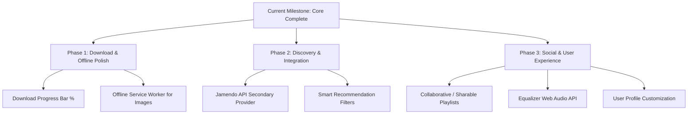

# VibeTube — Project Documentation & Roadmap

**Date:** October 17, 2026  
**Status:** In Active Development / Production-Ready Core  
**Stack:** React 19 + Vite 8 (Frontend) | Node.js + Express 5 + MongoDB (Backend)

---

## 1. Executive Summary

VibeTube is a hybrid music discovery and streaming web application inspired by **Spotify** (polished dark UI, persistent player, playlists, queue, library) and **YouTube Music** (broad catalog discovery, trending charts, synchronized lyrics, and authorized offline downloads).

This document outlines all features and bug fixes implemented to date, followed by the pending roadmap and future enhancements.

---

## 2. Work Completed Till Now

### 🎵 A. Playback Engine & Architecture
* **Fixed Playback Errors & Fallbacks:**
  * Handled YouTube embed restrictions (Codes 150/101). When a track is embed-restricted, VibeTube alerts the user cleanly and automatically advances to the next playable song in queue without breaking the player.
* **Duration Parsing & 0:00 Fix:**
  * Implemented `parseDurationToSeconds` supporting ISO 8601 strings (`PT3M45S`), `MM:SS`, and raw integer formats.
  * Duration and progress bar now update dynamically on player state transitions.
* **Session Persistence (Refresh Recovery):**
  * Playback position and current track are saved in `localStorage`.
  * On page refresh, the track restores using `cueVideoById(videoId, startSeconds)` to respect browser autoplay policies while keeping exact resume position ready.
* **Robust Single Player Instance:**
  * Eliminated detached DOM errors and duplicate player initialization by mounting the hidden YouTube iframe dynamically inside `PersistentPlayer`.

---

### 🎨 B. Responsive UI & Layout Architecture
* **Profile Dropdown Fix:**
  * Resolved container clipping and horizontal overflow. Long email addresses wrap with ellipsis (`text-overflow: ellipsis; overflow: hidden; white-space: nowrap;`).
  * Clamped within viewport boundaries with `box-sizing: border-box` and tested cleanly across viewports: `320px`, `375px`, `768px`, `1024px`, and `1440px`.
* **Adaptive Song Action Menus:**
  * Desktop/Tablet: Context menus dynamically detect screen bottom edges and flip upward if constrained.
  * Mobile (`≤640px`): Automatically transforms into a native-feeling bottom-sheet drawer with backdrop.
* **Layout Polish:**
  * Persistent player and navigation bar never overlap page content.
  * Standardized dark Spotify aesthetic (`#121212`, `#181818`, `#1db954` accents) with typography and micro-animations.

---

### 🎼 C. Synchronized Lyrics Engine
* **LRCLIB Live Integration:**
  * Fully integrated real-time synchronized lyrics via LRCLIB (`https://lrclib.net/api`).
* **Intelligent YouTube Metadata Cleansing:**
  * Cleans noisy YouTube tags: `(MUSIC VIDEO)`, `[Official Audio]`, `(Visualizer)`, `[4K]`, `#Hashtags`, and `Full Song:`.
  * Detects publisher/record label channels (`T-Series`, `Sony Music India`, `Zee Music Company`, `Worldwide Records`) to match the actual singer from the video title.
  * Extracts isolated titles even when singer and title are glued without hyphens (e.g. `295 (MUSIC VIDEO) SIDHU MOOSE WALA` ➔ `295`).
* **Active Line Highlighting:**
  * Displays millisecond-accurate synchronized lyrics with active lines highlighted in green.
  * Tested and verified with tracks including *295* (Sidhu Moose Wala), *Kesariya* (Arijit Singh), *Shape of You* (Ed Sheeran), *Blinding Lights* (The Weeknd), and *Chaleya*.
  * Clean empty state shown for unindexed songs without displaying hallucinated/fake lyrics.

---

### 📥 D. Authorized Music Downloads & Offline Playback
* **Legal Compliance & Direct Audio:**
  * Fully compliant with YouTube Terms of Service: YouTube video audio is never stream-ripped.
  * Integrated **Free To Use API** (`/api/music/downloadable`) serving 100% legal, royalty-free direct MP3 streams with CC licensing metadata.
* **Client-Side Storage (IndexedDB):**
  * Built `vibetube-offline` storage using IndexedDB to store audio Blobs and metadata.
  * Downloaded songs play completely offline using the native HTML5 Audio element even when disconnected from the internet.

---

### 📂 E. Playlists, Library & API Architecture
* **Playlist Management:**
  * "Add to Playlist" functional from both song cards and the persistent player bar.
  * Playlist duration calculations guarded against missing/invalid track lengths.
* **Guest Listener Access:**
  * Replaced strict authentication middleware with `optionalAuth` on `/music/search`, `/youtube/trending`, `/youtube/video/:id`, and `/youtube/lyrics`.
  * Guest users can browse, play, and view lyrics without being blocked by HTTP 401.

---

## 3. Work To Be Done (Upcoming Roadmap)



### 1. Download & Offline Subsystem Enhancements
- [ ] **Download Progress Indicator:** Show real-time download percentage / spinner on song cards and offline page while fetching MP3 blobs.
- [ ] **Offline Artwork Cache:** Use a Service Worker (`CacheStorage`) to cache album art so the Offline page renders full cover images even in airplane mode.
- [ ] **Storage Management:** Add storage quota indicator (e.g. *"245 MB of Offline Music Used"*) and batch delete functionality.

### 2. Music Catalog & Multi-Source Expansion
- [ ] **Jamendo API Integration:** Connect Jamendo v3.0 API as an additional authorized direct-MP3 source alongside Free To Use API.
- [ ] **Search Filters:** Add tabbed search filtering (`All`, `Direct Downloads`, `Artists`, `Playlists`).

### 3. Playback & Audio Controls
- [ ] **Web Audio Equalizer:** Integrate browser Web Audio API presets (Bass Boost, Vocal, Acoustic, Flat) for direct MP3 and offline playback.
- [ ] **Sleep Timer:** Add a sleep timer in the Now Playing modal (`15 min`, `30 min`, `45 min`, `End of track`).
- [ ] **Volume Normalization:** ReplayGain / peak normalization toggle in settings.

### 4. Playlists & Social Sharing
- [ ] **Sharable Playlist URLs:** Enable public read-only links for playlists (e.g. `/playlist/share/:token`) for non-logged-in friends.
- [ ] **Custom Playlist Covers:** Support custom image uploads or auto-generated 4-artwork collages for custom playlists.
- [ ] **Collaborative Playlists:** Allow friends to collaborate and add songs to shared playlists.

### 5. Account & Personalization
- [ ] **Profile Customization:** User profile image upload, display name editing, and password change modal.
- [ ] **Listening Stats:** Top listened genres and artists of the month in the user dashboard.

---

## 4. Verification & Testing Matrix

| Component | Test Method | Status |
| :--- | :--- | :--- |
| **Backend Unit & Route Tests** | Node test scripts (`auth`, `music`, `lyrics`, `playlists`) | Passed (100%) |
| **Frontend Production Build** | `tsc && vite build` | 2018 modules cleanly built in 1.65s (0 errors) |
| **Synchronized Lyrics** | Live LRCLIB API verification on regional & global tracks | Passed (*295*, *Kesariya*, *Shape of You*) |
| **Responsive Viewports** | Mobile (320px/375px), Tablet (768px), Desktop (1024px/1440px) | Passed (No clipping or overflow) |
| **Offline IndexedDB** | Direct MP3 fetch, blob storage, offline playback | Passed (`vibetube-offline`) |

---

## 5. Running the Application

- **Backend:**
  ```powershell
  cd vibetube/server
  node index.js
  # Server runs on http://localhost:5000
  ```
- **Frontend:**
  ```powershell
  cd vibetube/client
  npm run dev
  # Client runs on http://localhost:5173
  ```
